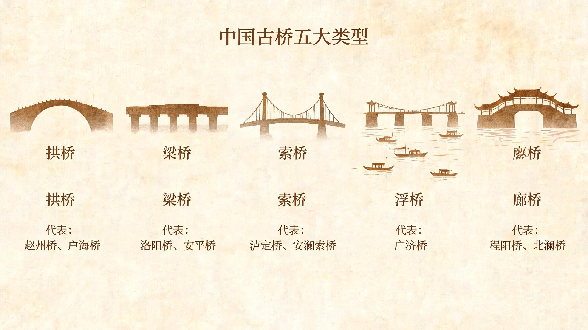

# 古桥千秋——中国古桥的多维数据可视化图谱


《古桥千秋——中国古桥的多维数据可视化图谱》是一个静态网页作品，核心内容包括中国古桥数据展示、地图交互、桥梁详情、技术演进、文化传承和语音导览。

## 作品亮点


- **空间维度**：中国古桥地理分布地图，按省份交互浏览
- **时间维度**：从先秦到明清的桥梁发展史时间轴
- **桥型维度**：拱桥、梁桥、索桥、浮桥、廊桥五大类型详解
- **文化维度**：诗词传说、历史故事、建造技艺
- **修缮维度**：保护现状、研究成果与修复技术




## 目录结构

```text
古桥千秋/
├─ 启动作品.bat
├─ README.md
├─ data/
│  └─ json/
├─ docs/
│  ├─ 古桥千秋-中国古桥多维数据可视化图谱.pptx
│  └─ presentation/  （网页版演示文稿）
├─ site/
│  ├─ index.html
│  ├─ map.html
│  ├─ detail.html
│  ├─ start_server.bat
│  └─ assets/
│     ├─ app.js
│     ├─ styles.css
│     ├─ vendor/
│     ├─ maps/
│     └─ audio/bridges/
└─ tools/
   └─ local-static-server.ps1
```

## 启动方式

推荐直接双击根目录下的 `启动作品.bat`。

脚本会优先使用项目自带的 PowerShell 本地静态服务器，不需要安装 Python 或 Node.js。启动后会自动打开：

```text
http://127.0.0.1:8000/site/index.html
```

如果 8000 端口被占用，脚本会自动尝试后续端口。若 PowerShell 本地服务无法启动，脚本会再尝试使用 Python 作为备用方案。

## 运行环境

- Windows 系统可直接使用 `启动作品.bat`
- 推荐浏览器：Microsoft Edge 或 Chrome
- 不建议直接双击 `site/index.html` 打开，因为浏览器可能拦截本地 JSON、地图和音频资源读取

## 离线资源

项目已将核心资源本地化：

- 图表与三维依赖：`site/assets/vendor/`
- 地图 GeoJSON：`site/assets/maps/`
- 桥梁数据：`data/json/`
- 108 个桥梁本地音频：`site/assets/audio/bridges/`

详情页语音导览调用顺序为：

```text
讯飞在线语音 -> 本地桥梁音频 -> 浏览器原生朗读
```

因此，即使外网不可用，作品仍可通过本地音频完成主要语音导览。

## Key 配置

作品中需要用到的接口配置已集中存放在：

```text
site/assets/runtime-config.js
```

当前包含：

- `aiModel`：AI 对话接口配置
- `xfyunTtsPool`：讯飞在线语音合成 Key 池
- `xfyunTts`：讯飞在线语音合成公共参数

页面会先加载 `runtime-config.js`，再加载 `app.js`，运行时自动从 `window.GUQIAO_RUNTIME_CONFIG` 读取配置。

> **注意**：`runtime-config.js` 包含真实 API 密钥，已被 `.gitignore` 排除，不会上传到 GitHub。
> 从 GitHub 克隆后，请复制模板文件并填入自己的密钥：
>
> ```text
> copy site\assets\runtime-config.example.js site\assets\runtime-config.js
> ```

## 演示文稿

项目附带完整的答辩演示文稿，提供两种格式：

- **PowerPoint 版**：`docs/古桥千秋-中国古桥多维数据可视化图谱.pptx`
- **网页版**：`docs/presentation/index.html`（浏览器直接打开即可播放）

内容涵盖作品总览、古桥地图、桥梁详情、桥型技术、数据洞察、文化传承、保护修缮及成果展望，配合网页作品使用可全面了解项目设计与实现思路。
